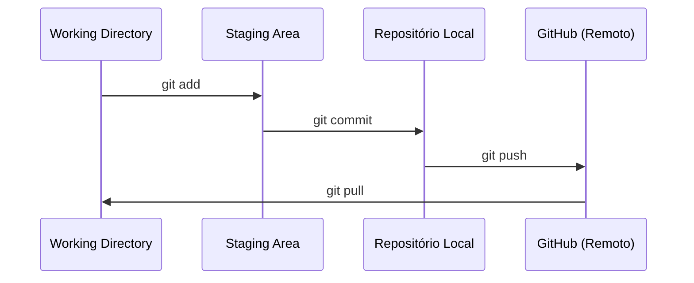
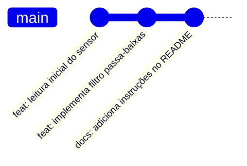
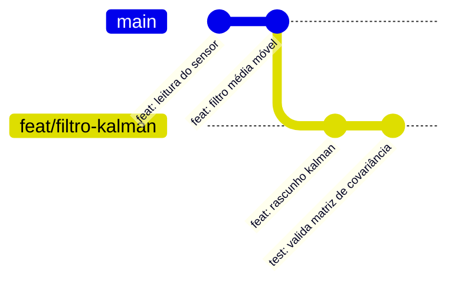
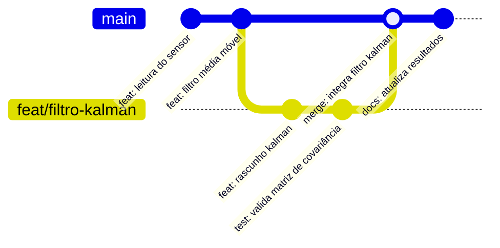

# Gestão de Versão: Git e GitHub

Ao trabalhar com códigos de pesquisa, é muito comum que, durante as etapas de alterações e testes, arquivos intermediários sejam criados manualmente a fim de preservar versões que já funcionavam. Desenvolver dessa maneira (diga-se de passagem, bastante rudimentar!) faz com que, às vésperas do prazo de entrega, a pasta do projeto acumule dezenas de arquivos nos quais até o próprio autor tem dificuldade de se localizar:

```text
projeto/
├── versao_1.py
├── versao_2.py
├── versao_3.py
├── versao_3_1.py
├── versao_final.py
└── versao_final_agora_vai.py
```

Com um sistema profissional de controle de versão, abandonamos esse hábito e passamos a rastrear toda a evolução do projeto mantendo apenas um único arquivo oficial para cada script.

## O que é Controle de Versão?

O controle de versão é a prática de gerenciar alterações em documentos e programas de computador de maneira sistemática e auditável. O **Git**, concebido como um sistema de controle de versão distribuído, destaca-se como o padrão absoluto da indústria e da ciência moderna. Ele captura o estado exato de todos os arquivos do projeto em um momento específico sempre que um registro (chamado *commit*) é realizado, criando uma linhagem imutável e verificável de toda a evolução da sua pesquisa.

### Git vs. GitHub

Para quem está começando, a distinção entre Git e GitHub costuma ser uma das primeiras dúvidas:

* **Git** é o software instalado localmente no seu computador, responsável por monitorar a pasta do projeto e gravar o histórico na sua máquina (funciona mesmo sem internet).
* **GitHub** é a plataforma na nuvem que hospeda os seus repositórios Git, permitindo backup remoto, trabalho em equipe e revisão de código com seu orientador e colegas de laboratório.

## Os Três Estados do Git

Compreender o funcionamento do Git exige enxergar o fluxo de trabalho dividido em três áreas locais, além do repositório remoto:

1. **Working Directory (Diretório de Trabalho):** É a pasta visível no seu computador onde você edita seus scripts e textos normalmente. As alterações feitas aqui ainda não estão salvas no histórico do Git.
2. **Staging Area (Área de Preparação):** Funciona como uma zona de seleção. Você escolhe quais arquivos modificados deseja incluir no próximo pacote de registro histórico usando `git add`.
3. **Local Repository (Repositório Local):** É o banco de dados local (dentro da pasta oculta `.git`) onde o Git armazena permanentemente os instantâneos (*commits*) gerados com `git commit`. Uma vez aqui, aquele estado do código pode ser recuperado a qualquer momento.



## Conceitos Fundamentais para a Pesquisa

### Commits e a Linha do Tempo

Um *commit* deve ser entendido como um "ponto de verificação" (*checkpoint*) do seu projeto. Cada *commit* recebe um código identificador único (hash) e registra quem fez a alteração, quando ela foi feita e uma mensagem explicando o motivo da mudança.



### Branches (Ramos)

O conceito de *branch* permite criar linhas de tempo paralelas e independentes. O ramo principal e estável do projeto é convencionalmente chamado de `main`.

Ao testar uma nova hipótese ou algoritmo que diverge da linha principal — por exemplo, experimentar um Filtro de Kalman no lugar de uma média móvel —, cria-se uma nova *branch*. Isso garante que a simulação principal que já funciona permaneça intacta na `main` enquanto o desenvolvimento experimental avança isoladamente.



### Merges e Conflitos

A fusão (*merge*) é o processo de reintegrar uma *branch* experimental validada de volta ao tronco principal (`main`).



Se as mesmas linhas de um mesmo arquivo tiverem sido alteradas de formas diferentes em ambos os ramos, o Git interrompe a fusão automática e sinaliza um **Conflito de Merge** (*Merge Conflict*), solicitando que o pesquisador escolha manualmente qual versão manter.

### Sincronização com `git push` e `git pull`

Enquanto comandos como `git add` e `git commit` operam exclusivamente na sua máquina local, o comando `git push` é o responsável por enviar os seus novos *commits* locais para o servidor remoto (GitHub), atualizando o ponteiro remoto (`origin/main`). No sentido inverso, o `git pull` traz as atualizações feitas por seus colegas no GitHub para o seu computador.

## Convenções de Commits (*Conventional Commits*)

Quando fazemos alterações em um projeto científico, é fundamental que o histórico de mensagens explique **o que** mudou e **qual o propósito** da mudança. Mensagens vagas como `"atualização"`, `"ajustes"` ou `"teste 2"` tornam impossível encontrar quando um erro foi introduzido.

No GREI-UFC, adotamos o padrão [**Conventional Commits**](https://www.conventionalcommits.org/pt-br/), que estrutura a mensagem no formato:

```text
<tipo>: <descrição curta no imperativo ou presente>
```

| Prefixo (`<tipo>`) | Quando utilizar na pesquisa | Exemplo prático |
| :--- | :--- | :--- |
| **`feat:`** | Adição de uma nova funcionalidade, script ou algoritmo. | `feat: adiciona cálculo de THD para sinal trifásico` |
| **`fix:`** | Correção de um bug ou erro matemático no código. | `fix: corrige fator de escala na conversão ADC` |
| **`docs:`** | Alterações exclusivas na documentação (`README`, `docs/`, docstrings). | `docs: explica parâmetros do controlador PID` |
| **`test:`** | Adição ou correção de testes automatizados (`pytest`). | `test: adiciona validação para vetor de tensão vazio` |
| **`refactor:`** | Melhoria na estrutura do código sem alterar seu comportamento matemático. | `refactor: separa leitura serial da função de plotagem` |
| **`ci:`** | Configuração de automações e workflows (ex: GitHub Actions). | `ci: configura deploy automático do MkDocs` |
| **`chore:`** | Tarefas de manutenção, atualização de pacotes (`uv.lock`) ou `.gitignore`. | `chore: adiciona scipy e atualiza uv.lock` |

---

## Veja Também

* 💡 **Próximo conceito:** [Isolamento de Ambientes e Gestão de Dependências](isolamento-ambientes.md)
* 🎓 **Na prática:** [Tutorial 2: Primeiros Passos com Git e GitHub](../tutorials/primeiro-git.md)
* 🛠️ **Guias rápidos:** [Como Trabalhar com Branches, Pull Requests e Releases](../how-to/fluxo-branches-pull-requests.md) e [Como Resolver Conflitos de Merge no Git](../how-to/resolver-conflitos-git.md)
* 📖 **Referência:** [Consulta Rápida: Comandos Git](../reference/comandos-git.md)
