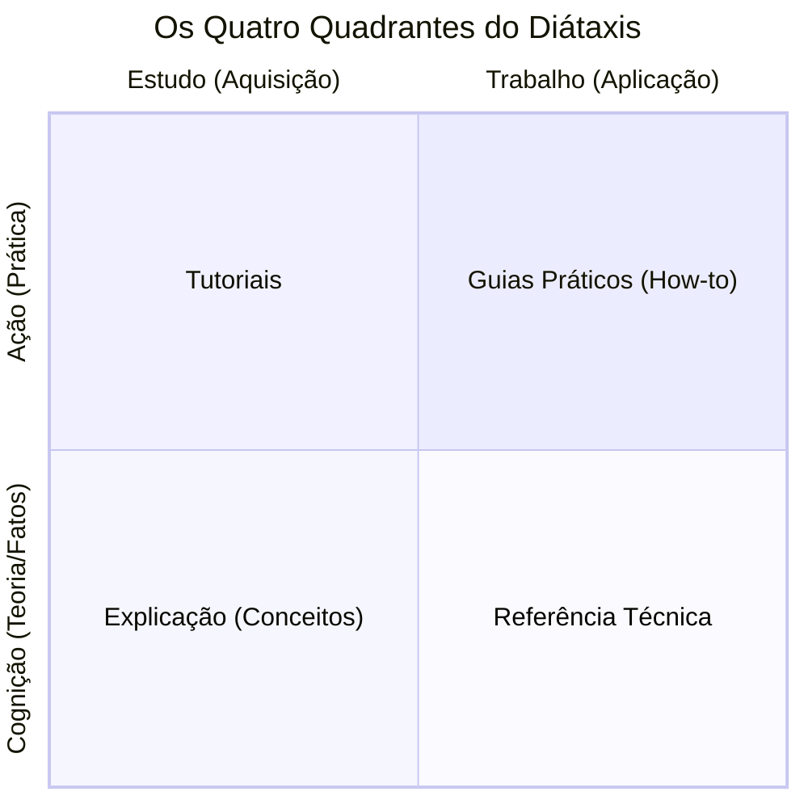

# Arquitetura da Informação: A Filosofia Diátaxis

A documentação de software e de experimentos científicos é frequentemente tratada como uma tarefa secundária. No entanto, em grupos de pesquisa de Engenharia Elétrica, onde o conhecimento precisa ser transferido continuamente entre gerações de estudantes de IC, mestrado e doutorado, a qualidade da documentação é o principal determinante da longevidade de um projeto. Este documento introduz a **Metodologia Diátaxis**, o framework estrutural adotado pelo GREI-UFC.

## A Entropia da Documentação

Historicamente, a documentação acadêmica sofre daquilo que especialistas chamam de *"entropia"* ou *"apodrecimento do conhecimento"*. Isso ocorre quando a documentação é escrita como um texto monolítico: deduções matemáticas sobre a Transformada de Fourier interrompem instruções passo a passo de como instalar o software, enquanto parâmetros técnicos de uma função ficam perdidos no meio de discussões conceituais.

Essa mistura aumenta a carga cognitiva do leitor e dificulta tanto o aprendizado de novos membros quanto a consulta rápida por veteranos.

## O Framework Diátaxis

Concebido por Daniele Procida, o termo **Diátaxis** deriva do grego antigo e significa *"arranjo sistemático"*. A premissa central é que a documentação técnica não deve refletir apenas a estrutura interna do código, mas sim as **necessidades cognitivas do leitor** em diferentes momentos de sua interação com o projeto.

O framework organiza a documentação em quatro quadrantes, baseados no cruzamento de dois eixos:

* **Ação vs. Cognição:** Distingue entre o momento em que o usuário *faz* (prática) e o momento em que o usuário *estuda/consulta* (conhecimento).
* **Aquisição vs. Aplicação:** Distingue entre o momento de *aprendizado* em um ambiente guiado e o momento de *trabalho produtivo* em um problema real.

### Os Quatro Quadrantes na Pesquisa Científica

Para estruturar a documentação de um projeto de excelência, o conteúdo deve ser distribuído nas quatro categorias abaixo:

| Quadrante | Foco e Natureza | Objetivo Científico / Técnico | Exemplo na Engenharia Elétrica |
| :--- | :--- | :--- | :--- |
| **Tutoriais** | Aprendizado (Ação) | Guiar o aluno iniciante pela mão em uma experiência controlada e linear. Foco no sucesso imediato. | *"Como configurar seu ambiente e rodar sua primeira simulação de circuito."* |
| **Guias (How-to)** | Resolução de Tarefas (Ação) | Fornecer passos exatos para um usuário que já sabe o que quer alcançar em um cenário real. | *"Como exportar os dados do osciloscópio para um arquivo CSV padronizado."* |
| **Referência** | Informação Factual (Cognição) | Listar especificações técnicas de forma objetiva e direta, sem narrativa. | *"Tabela de parâmetros, unidades em SI e retorno da função de calibração do sensor."* |
| **Explicação** | Entendimento (Cognição) | Discutir a teoria, o contexto e a justificativa das escolhas de projeto. | *"Por que optamos por um filtro digital IIR Butterworth em vez de um FIR nesta bancada."* |

!!! tip "A Regra de Ouro do Diátaxis"
    Mantenha a separação de responsabilidades: se você sentir vontade de deduzir a equação matemática de um algoritmo no meio de um **Tutorial** prático, pare, crie um documento de **Explicação** separado e insira apenas um link no tutorial apontando para lá.

---

## Veja Também

* 💡 **Próximo conceito:** [Testes Automatizados: O Rigor Científico no Código](testes-automatizados.md)
* 🎓 **Na prática:** [Tutorial 4: Documentando com MkDocs](../tutorials/documentando-mkdocs.md)
* 🛠️ **Guias rápidos:** [Como Escrever um README Profissional](../how-to/escrever-readme.md) e [Como Publicar no GitHub Pages](../how-to/publicar-github-pages.md)
