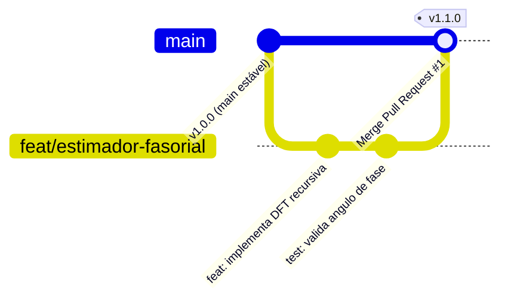

# Como Trabalhar em Equipe com Branches, Pull Requests e Releases

Quando um projeto de pesquisa envolve mais de uma pessoa — ou quando você precisa que seu orientador revise uma alteração antes de integrá-la ao código principal —, fazer *commits* diretamente na branch `main` torna-se arriscado.

Neste guia, você aprenderá o fluxo de trabalho padrão do **GREI-UFC** baseado em **Branches**, **Pull Requests (PR)** e **Releases (Tags)** para manter o repositório sempre estável e auditável.

## Problema

Você quer implementar um novo algoritmo (por exemplo, um estimador de estado ou um novo filtro digital) sem correr o risco de quebrar o código principal que já está gerando os resultados do laboratório, e precisa submeter essa mudança para revisão antes de oficializá-la.

## Solução: O Fluxo de Trabalho com Branches (*GitHub Flow*)



### Passo 1: Crie uma Branch com Nome Padronizado

Antes de começar a programar uma nova tarefa, certifique-se de estar na branch `main` atualizada e crie uma nova *branch* usando os prefixos do laboratório:

* `feat/<nome-curto>`: para novos algoritmos, scripts ou funcionalidades.
* `fix/<nome-curto>`: para correção de erros matemáticos ou bugs.
* `docs/<nome-curto>`: para escrita ou atualização de manuais e documentação.
* `exp/<nome-curto>`: para testes exploratórios de bancada ou simulações temporárias.

No terminal, execute:

```bash
git checkout main
git pull origin main
git switch -c feat/estimador-fasorial
```

### Passo 2: Desenvolva, Teste e Faça Commits Atômicos

Trabalhe normalmente nos seus arquivos dentro de `src/` e `tests/`. Faça *commits* pequenos e focados utilizando o padrão [Conventional Commits](../explanation/controle-de-versao.md#convencoes-de-commits-conventional-commits):

```bash
# Valide se os testes passam antes de registrar
uv run pytest

# Prepare e registre a alteração na sua branch
git add src/estimador.py tests/test_estimador.py
git commit -m "feat: adiciona estimador fasorial recursivo de 60Hz"
```

### Passo 3: Envie a Branch para o GitHub

Publique a sua *branch* de trabalho no servidor remoto:

```bash
git push -u origin feat/estimador-fasorial
```

### Passo 4: Abra um Pull Request (PR) para Revisão

1. Ao acessar a página do repositório no GitHub, você verá um aviso amarelo com o botão **"Compare & pull request"**. Clique nele.
2. Escreva um título claro e, na descrição, resuma:
   * O que foi implementado ou corrigido.
   * Como o código foi validado (ex: resultados do `pytest` ou gráficos gerados).
3. No menu lateral direito (**Reviewers**), selecione seu orientador ou colega de laboratório.
4. Clique em **"Create pull request"**.

!!! tip "Revisão de Código Científica"
    No Pull Request, o revisor pode comentar linha por linha do seu código, sugerir melhorias matemáticas e verificar se os testes passaram. Após a aprovação, basta clicar no botão verde **"Merge pull request"** no próprio GitHub!

---

## Congelando Versões para Artigos e TCC (*Releases e Tags*)

Submeteu um artigo para congresso/periódico ou entregou a versão final do TCC? Você deve **marcar (*tag*)** exatamente qual *commit* gerou os gráficos daquele documento.

Seguimos o **Versionamento Semântico (`vMAIOR.MENOR.CORRECAO`)**, como `v1.0.0`:

```bash
# 1. Na branch main atualizada, crie uma tag anotada
git checkout main
git pull origin main
git tag -a v1.0.0 -m "Versao utilizada nos experimentos do artigo CBA 2026"

# 2. Envie a tag para o GitHub
git push origin v1.0.0
```

No GitHub, essa *tag* ficará registrada permanentemente na seção **Releases**, permitindo que qualquer avaliador baixe o código no estado exato em que o artigo foi escrito, mesmo que a pesquisa continue evoluindo nos meses seguintes!

---

## Veja Também

* 💡 **Conceito:** [Gestão de Versão: Git e GitHub](../explanation/controle-de-versao.md)
* 🛠️ **Conflitos:** [Como Resolver Conflitos de Merge no Git](resolver-conflitos-git.md)
* 📖 **Referência:** [Consulta Rápida: Comandos Git](../reference/comandos-git.md)

